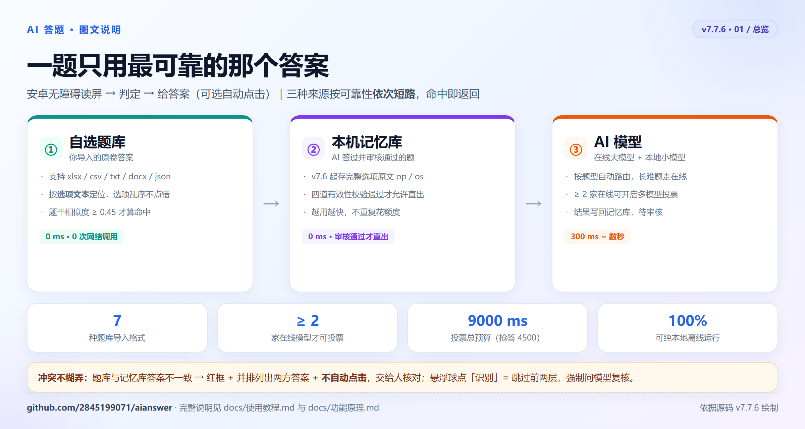
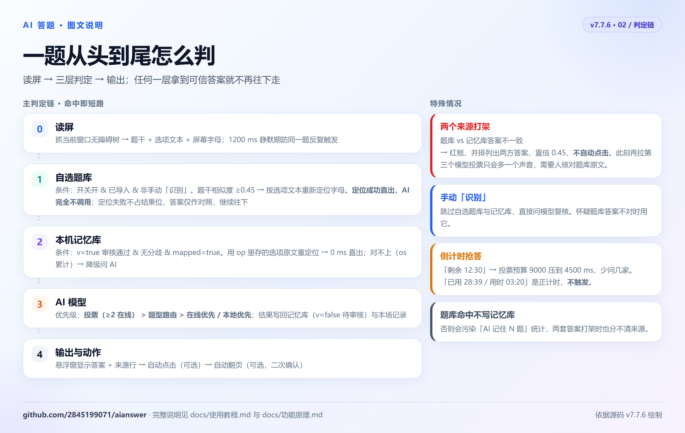
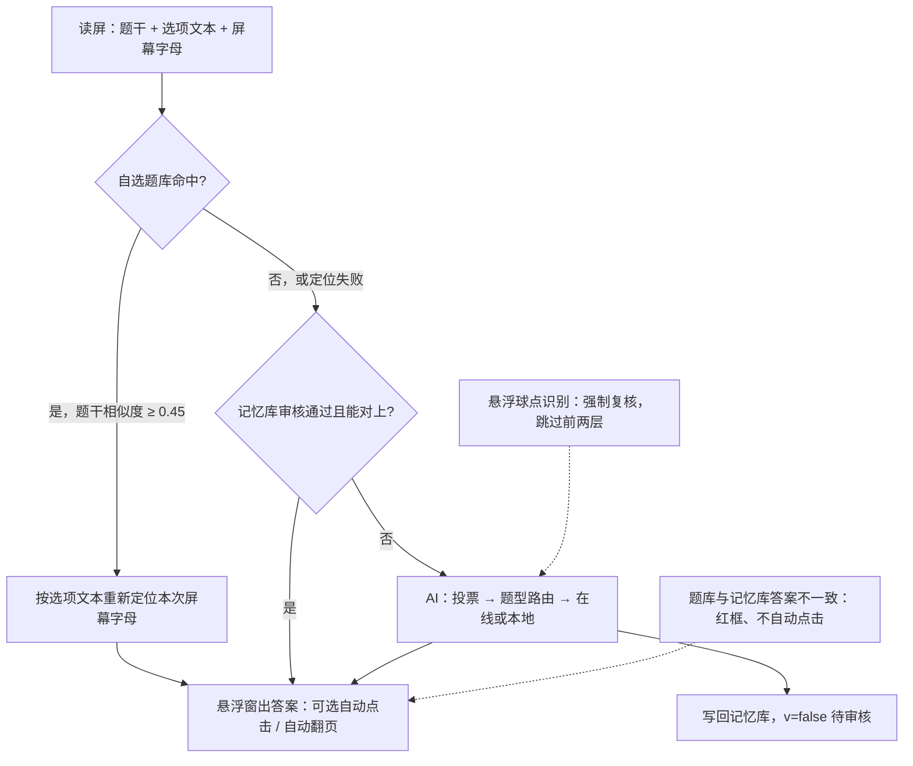
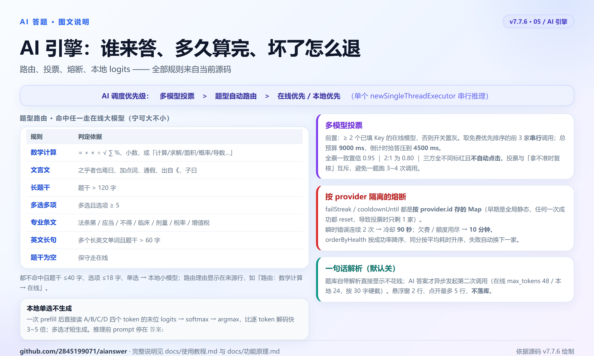
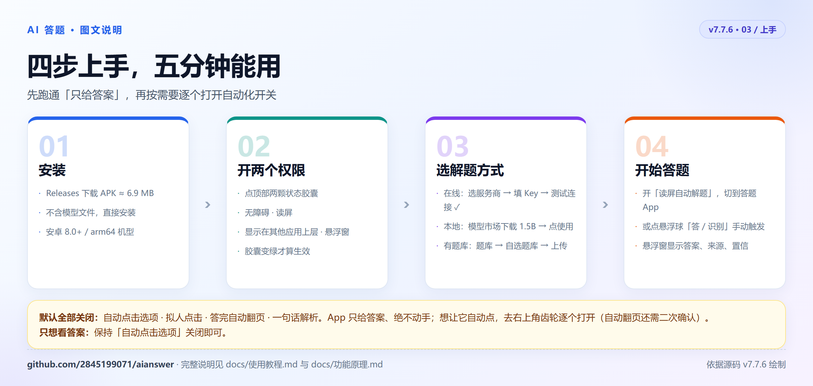

# AI答题



> **看图更快**：[在线图文导览（推荐）](https://2845199071.github.io/aianswer/) ｜ [使用教程](docs/使用教程.md) ｜ [功能原理](docs/功能原理.md) ｜ [六张信息图原图](docs/images/)
> 六张图分别讲：总览 · 四步上手 · 判定链 · 界面与悬浮窗 · AI 引擎 · 题库规则；点击任意一张可看高清原图。

安卓无障碍读屏 → 给出选项答案（可选自动点击）。

- **当前版本 v7.7.6**（versionCode 776）｜[Releases 下载 APK](https://github.com/2845199071/aianswer/releases)（约 6.9 MB，不含模型）
- 三种答案来源按可靠性依次短路：**自选题库 → 本机记忆库 → AI 模型**
- 通道支持在线大模型（智谱 / DeepSeek 等 OpenAI 兼容接口）与本地 llama.cpp 小模型，可按题型自动路由、多模型投票
- 自动点击、拟人点击、自动翻页、一句话解析都是**独立开关**；拟人点击 / 自动翻页 / 解析默认关

**先上手：[使用教程](docs/使用教程.md)（安装、授权、导入题库、设置项、常见问题）**
**想看实现：[功能原理](docs/功能原理.md)（读屏、三层判定链、冲突仲裁、路由投票、点击翻页的具体逻辑）**

> 在线模式会把题目发给所选服务商；只开本地则全程离线。API Key 只存在本机 `SharedPreferences`，不上传、不经中转。

---

## 一、一题是怎么判出来的





<details><summary>纯文本版流程图（点开）</summary>

```
读屏（题干 + 选项文本 + 屏幕字母）
 ├─① 自选题库（设置开关开 && 已导入 && 非手动「识别」）
 │     题干相似度 ≥0.45 才算命中，答案按【选项文本】在当前屏幕重新定位
 │     定位成功 → 毫秒级出答案，AI 不被调用、不烧额度
 │     定位失败 → 不占结果位，题库答案只作对照，继续往下走
 │
 ├─② 本机记忆库（v=true 审核通过 && 无分歧）
 │     用存下的选项原文重新定位（抗选项乱序）→ 0ms 出答案
 │
 └─③ AI：投票（≥2 在线模型）> 题型路由 > 在线优先 / 本地优先
        答完写回记忆库 + 本场记录
```

</details>

**自选题库排在最前**：它是用户导入、可对照原卷复核的权威数据；记忆库是 AI 自己攒的推断结果。
题库与记忆库答案不一致时，以题库为准，同时悬浮窗变红框并列出两方答案，**不自动点击**，提醒人工核对而不是再拉一个模型投票。

悬浮球点「识别」= 强制复核：跳过题库和记忆库，直接问模型。

---

## 二、主要功能

### 自选题库（从「刷题助手·固定题库版」移植并加固）
- 系统文件选择器导入，支持 `.xlsx / .xlsm / .csv / .tsv / .txt / .docx / .json`；老式 `.xls` 需另存为 `.xlsx`
- 自动在前 30 行里找表头、跳过「导入须知」；答案支持 `ABCD` 连写、`A,B`、正确/错误、`√/×`，也支持直接写选项原文
- 题干/答案匹配复用 `Matcher.norm / symSig / matchBest / findTextIndex`，**按选项文本定位而不是字母**，所以选项乱序不会点错
- 三处加固：题干相似度下限 `MIN_STEM=0.45`（防同批选项的相邻题误命中）、题干 ≥0.95 时豁免选项分、多份题库合并检索
- 导入索引记在 `SharedPreferences`，文件被清理工具删掉时界面显示「文件丢失，请重新导入」

### 本机记忆库 / 题库中心
- 条目存完整选项原文（`op`: 字母 → 文本），命中时「字母 → 文本 → 屏幕重新定位」，选项换序照样能答对
- 四道有效性校验：写入必须带选项、命中文本必须对得上、连续 2 次定位失败打回待确认、只有审核通过才允许 0ms 直出
- 冲突仲裁五级：手改答案锁定为金标准 > 模型一致 > 不一致只记 `cf[]` 不覆盖 > 累计 2 条同答案才提示是否更新 > 新题首次写入；多选按集合完全相等才算一致
- 错题本、答题统计、批量删除（可跨筛选累计、8 秒撤销）、本场记录、未命中题导出到 `下载/AI答题/`

### AI 调度
- **题型路由**：数学计算、文言文、长题干、多选多项、专业条文走在线大模型；短题常识走本地小模型；可关闭
- **多模型投票**：需 ≥2 个已填 Key 的在线模型才能开启（否则开关置灰），串行取多数，全票一致置信 0.95，三方分歧不自动点击；与「复核」互斥，避免重复烧额度
- **在线/本地双通道**：云端失败（Key 失效、429、断网）自动回退本地；熔断按 provider 隔离，厂商按成功率 / 耗时动态排序
- **模型市场**：独立二级弹窗，每个模型标注适用题型、体积、单题耗时、模板格式（如文言文专用），下载后可热插拔切换；清单在 `assets/models.json`，加模型不必发版
- **简洁解析**：≤30 字、悬浮窗最多 2 行，点开看全文；题库自带解析直接显示不花钱，AI 解析才额外调用一次



### 点击与翻页
- **拟人点击**（默认关）：80~200ms 随机延迟 + ±3dp 偏移，只改手感不改答案；节点 `ACTION_CLICK` 永远优先，手势仅作兜底（避免 `dispatchGesture` 返回 true 但控件没收到的「假成功」）
- **答完自动点「下一题」**（默认关，学自刷题助手）：只有真的点过选项才翻页、只在本 App 内翻页、防连点 1200ms，开启需二次确认；找不到「下一题」或题干连续 3 次不变会停下
- 低置信度（默认阈值可设）只显示、不点击

---

## 三、设置项（主界面 → 设置）

| 分组 | 开关 | 说明 |
|---|---|---|
| 解题行为 | 自动点击选项 / 多自信才自动点击 | 低于阈值只显示 |
| 解题行为 | 拟人点击 | 依赖自动点击，默认关 |
| 解题行为 | 答完自动点「下一题」 | 依赖自动点击，默认关，会一题接一题连答 |
| 解题行为 | 出答案时振动提示 | — |
| 模型与额度 | 先查自选题库，没命中再问 AI | 题库命中毫秒级、不花额度；未导入题库时不生效 |
| 模型与额度 | 自动选择模型（按题型路由） | 只配一条通道时不生效，设置里会橙色提示 |
| 模型与额度 | 多模型投票 | 需 ≥2 个在线模型；开启后「复核」自动关闭 |
| 模型与额度 | 拿不准时复核 | 仅低置信触发，两路不同标红不自动点 |
| 模型与额度 | 出答案附一句解析 | 默认关 |

倒计时识别会区分「剩余时间」和「已用时」，只有真倒计时才触发提速；思考中悬浮窗也会避让题目区域。

---

## 四、使用



**只开在线（最省事）**
1. 装 APK → 打开，授予无障碍 + 悬浮窗权限
2. 「在线模型」里选服务商 → 填 API Key → 「测试连接」显示 ✓
3. 有自选题库就到「题库 → 自选题库」导入（可选）
4. 打开「读屏自动解题」，切到答题 App 即可；悬浮球可拖动，点「识别」强制问模型

**再加本地兜底**：到「本地模型 → 模型市场」下载 1.5B 档位（约 1.07 GB），下载完设为当前，断网也能答。

两种通道对比：

| | 在线（智谱 GLM-4.7-Flash） | 在线（DeepSeek V4.1-Flash） | 本地 1.5B |
|---|---|---|---|
| 准确率 | 高 | 高 | 90%（难题） |
| 单题耗时 | 0.5~1.5 s | 0.5~1.5 s | 0.3~0.8 s |
| 成本 | 免费 | ≈ 0.0005 元/题 | 0 |
| 额外下载 | 无 | 无 | 1.07 GB |
| 断网可用 | 否 | 否 | 是 |

---

## 五、结构

```
app/src/main/java/com/dsh/aianswer/
  QService.java          无障碍服务：读屏 → 三层判定 → 点击 → 自动翻页
  ScreenScan.java        节点抓取 + 点击（节点优先，手势兜底）
  Layout.java  Matcher.java       版面解析 / 题干·选项文本匹配（纯 Java 可单测）
  SelfBank*.java Importer.java XlsxReader.java DocxReader.java TextParser.java
                         自选题库：导入、解析、存储、命中
  Record.java  AnsResolver.java   记忆库存储 / 按选项文本重新定位
  AnswerEngine.java  Router.java  CloudSolver.java  PromptBuilder.java
                         调度（投票 > 路由 > 在线/本地）、熔断、健康度排序
  ModelManager.java  ModelMarket.java   模型下载续传、热插拔、市场清单
  MissLog.java  TimerDetect.java  Prefs.java  Overlay.java  MainActivity.java
app/src/main/assets/models.json        模型市场清单
app/src/main/jniLibs/arm64-v8a/        libllama / libggml* / libaiq（llama.cpp 交叉编译，NDK 28.2）
docs/                                  各版本设计与验证记录（见下）
```

纯逻辑类（`Router / AnsResolver / TimerDetect / Matcher / SelfBankMatch / MissLog / Layout / Importer / TextParser / XlsxReader / DocxReader / Record`）不依赖 Android，可直接在 JVM 上跑断言测试。

## 六、构建

前置：JDK 17 + Android SDK（Platform 34、Build-Tools 34.0.0）。

```bash
echo "sdk.dir=/path/to/android-sdk" > local.properties
bash build.sh                # 默认 1 / 1.0.0
bash build.sh 776 7.7.6      # 指定 versionCode / versionName
```

- 签名密钥 `keystore/aianswer.jks` 不入库。没有它也能构建，产出**未签名 APK**；想出签名包，把自建 jks 放到该路径（PKCS12，alias `qh`，密码用环境变量 `KS_PASS`）
- JDK / build-tools 路径可用 `JAVA_HOME`、`ANDROID_BT` 覆盖
- 产物：`构建/AI答题-v<版本>.apk`（约 6.9 MB，不含模型）

## 七、文档

| 文档 | 内容 |
|---|---|
| **[在线图文导览](https://2845199071.github.io/aianswer/)** | 六张信息图串起来的可视化首页：总览、上手、判定链、界面、AI 引擎、题库规则；也可直接打开 [docs/index.html](docs/index.html) |
| **[六张信息图](docs/images/)** | `overview / quickstart / flow / ui / engine / bank` 高清 PNG 原图，可单独取用 |
| **[使用教程](docs/使用教程.md)** | 安装授权、上手配置、主界面与悬浮球、题库导入格式、题库中心、设置项逐条说明、常见问题、数据与隐私 |
| **[功能原理](docs/功能原理.md)** | 无障碍读屏与坐标排序、版面解析、同题判重、三层判定链、记忆库字段与四级校验、五级冲突仲裁、题型路由/投票/熔断、本地 logits 推理、点击与自动翻页、悬浮窗、设计取舍 |
| [需求规格说明书-v7.1](docs/需求规格说明书-v7.1.md) | 题库冲突仲裁、解析、路由、投票、模型市场、权限与技术选型 |
| [自选题库集成说明](docs/自选题库集成说明.md) | 从刷题助手移植的匹配逻辑、与 AI 流程的衔接、数据格式 |
| [v7.5 改进说明](docs/v7.5-改进说明.md) | 倒计时提速、厂商健康度排序、思考中避让、外框告警、导出未命中题 |
| [v7.6 记忆库选项存储](docs/v7.6-记忆库选项存储.md) | 字段调整、按文本匹配、旧数据迁移、四道有效性校验 |
| [v7.7 双来源判定与自动翻页](docs/v7.7-双来源判定与自动翻页.md) | 题库/记忆库答案冲突、自动翻页、手势点击假成功的修复与验证 |

## 八、已知限制

- **图片题抓不到**：无障碍树里图片没有文字，纯文本方案会返回空，需要截图 + 多模态模型才能支持
- **多选不如单选准**：本地多选走短生成，准确率低于单选；在线多选较稳
- **只支持 arm64**：x86 设备装不上
- **智谱免费档有并发限制**（约 1 次/秒），切题过快会 429，此时自动回退本地
- v7.6 之前存的旧记忆没有选项原文，命中时会多问一次 AI 用于补全（一次性），补完后才按文本定位
- 题库/记忆库答案不一致的红框、真机选项乱序场景目前只有 JVM 断言覆盖，未在真机造数验证

## 九、权限

| 权限 | 是否必需 | 用途 |
|---|---|---|
| 无障碍服务 | 必需 | 读取题干与选项、执行点击 |
| 悬浮窗 | 必需 | 显示答案悬浮球 / 悬浮窗 |
| 互联网 | 在线模式必需 | 调用云端模型、下载本地模型 |
| 存储 | 不需要 | 题库用系统文件选择器（SAF）读取，导出走 MediaStore 下载目录 |
