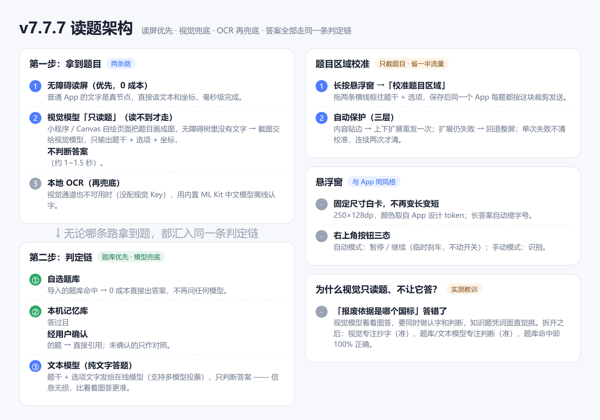
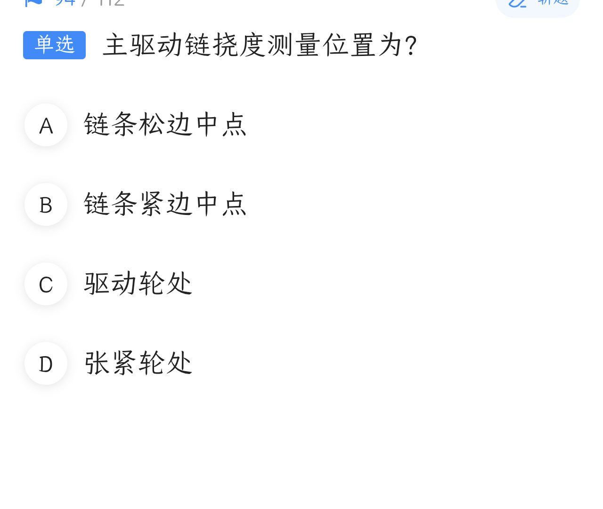
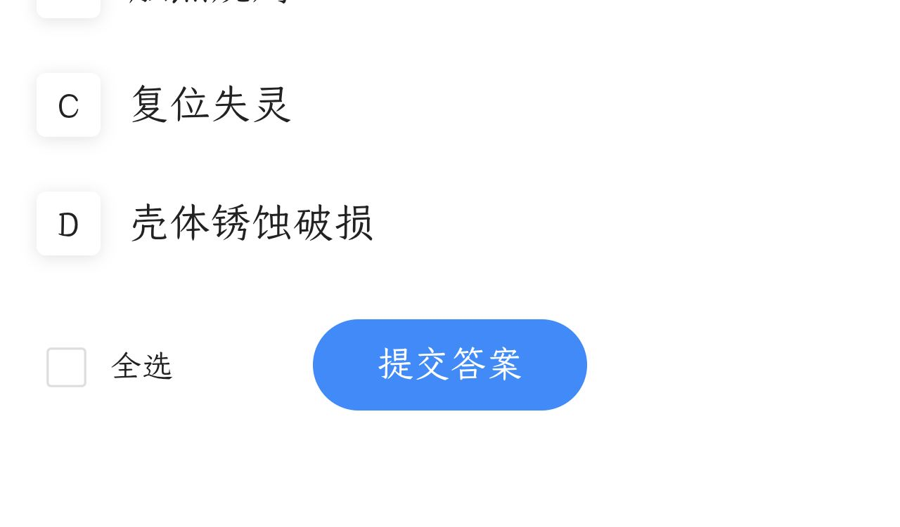
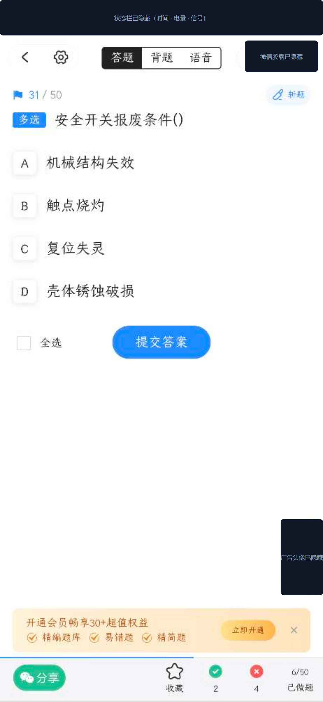

# v7.7.7 更新说明（重大更新）

> 本版本解决了一个根本性问题：**微信小程序这类把题目画成图片的页面，之前完全无法答题**。
> 围绕它重做了一套「视觉读题」架构，并顺手修掉了调试过程中暴露的 8 个真实缺陷。
> 本文记录每个问题是怎么发现、为什么发生、怎么解决的——全部经过真机验证。



## 一、核心问题：小程序读不到题

**现象**：在自己的考试 App（原生文本）上一切正常，换成微信小程序里的题目就一直「识别中…」，永远不出答案。

**排查过程**：给 App 加了节点快照导出，点一次「识别」后把无障碍树实际读到的内容拉出来看——

| 屏幕上 | 无障碍树里 |
|---|---|
| 题干「梯级报废判定情形()」 | ❌ 不存在 |
| A/B/C/D 四个选项 | ❌ 一个都没有 |
| 顶部 tab、广告、底部统计 | ✅ 只有这 22 段 |

**原因**：小程序用 Canvas / Skyline 自绘渲染，屏幕上画出来了，但没往无障碍树里写语义。程序按无障碍读屏的方式「看」页面时，题目区域是空白。这不是权限或机型问题，是这类页面**天生读不到**。

**解决**：三层兜底，读屏拿不到题就自动降级——

```
读屏（0 成本，毫秒级）
  ↓ 读不到
视觉模型「只读题」：截图 → 题干 + 选项 + 坐标（约 1~1.5 秒，不判断答案）
  ↓ 视觉也不可用（没配 Key）
本地 OCR：内置 ML Kit 中文模型，离线认字
  ↓ 都不行
悬浮窗明确提示原因（不再装死）
```

**关键设计——视觉只读题、不让它答**：最初让视觉模型直接给答案，实测遇到「主驱动链报废依据是哪个国标」这种知识题，它凭词面直觉选了更有名的 GB 16899（扶梯安全规范），正确答案是 GB/T 31821（报废技术条件）——**原版 DeepSeek 网页版也答错**，说明是模型记忆问题，调参数救不了。真正的解法是把「认字」和「判断」拆开：

- 视觉模型只做它擅长的：把图抄成字（符号 `≤`、形近字都不容易错）；
- 判断交给判定链：**自选题库（命中即 100% 对）→ 记忆库 → 文本模型**。

这样你导入的题库终于能参与视觉路径——之前视觉直接给答案，把整个题库绕过去了。

## 二、看图答题太慢太贵：13.7 秒 → 1.3 秒

**现象**：视觉路径刚通时，单题耗时 6.6~13.7 秒，没法用。

**原因**：查 DeepSeek 文档发现，V4 系列默认开启**思考模式（thinking, effort=high）**——先写几百到两千 token 的推理再给答案，思考 token 还按输出价计费（输入价的 4 倍）。

**解决与反复**：

1. 先彻底关思考（`"thinking":{"type":"disabled"}`，注意 `enable_thinking:false` 和 `reasoning:{enabled:false}` 是**无效写法**）→ 降到 **1.3 秒**；
2. 随后发现关思考对概念辨析题有影响 → 折中为答题时开 `low`（约 2~3 秒）；
3. 最终架构拆成「视觉抄字 + 文本判断」后，视觉这步**不需要思考**（关掉），文本模型那步本来就快。总耗时稳定在 1.5~2.5 秒。

费用实测：输入约 1400 token + 输出约 200 token ≈ **0.2 分钱/题**（空闲时段），刷 100 题约 2 毛钱。

## 三、只截题目区域：从猜到校准

整屏发送有大量浪费（顶部广告、底部会员条占了画面一半以上），但「该截哪里」很难自动猜对。

**第一次尝试（失败）**：让视觉模型返回选项坐标，据此算裁剪框。实测它返回的横向框只包住「A」那个字母圈，裁出来是 **371px 宽的竖条**，选项文字整条被切。模型居然还能答对——靠残缺信息猜的，不可信。

**第二次尝试（可靠）**：把定区域这件事交给用户，一次校准永久生效——

**长按悬浮窗 →「校准题目区域」→ 拖两条横线框住题干和选项 → 保存**。之后同一个 App 每题都按这块裁剪发送。


*校准后实际发给模型的图：只有「单选 + 题干 + A/B/C/D」，1280×1082、51KB（整屏是 1280×2772、93KB）。*

调试这个功能时踩了三个坑，都已修复：

1. **包名取错**：点保存时焦点在校准窗口上，取到的包名是自己的 App，区域挂在错误包名下，对微信永远匹配不上 → 现在取到自己的包名就存成「通用区域」；
2. **被自动推断覆盖**：自动识别成功一次就用它的坐标重算并写回，冲掉用户校准 → 加了「手动校准」标记，自动推断一律不许覆盖；
3. **显示尺寸 ≠ 截图尺寸**（最隐蔽）：校准界面量到的高度不含导航栏（2620），系统截图含导航栏（2772），差 5.8%，严格相等比较直接判无效 → 改为容差 6% 并按比例换算。

**区域不够怎么办（长选项、折行题）**——三层自动保护：

- **贴边检测**：识别完检查选项坐标是否贴住裁剪框边缘，贴边说明内容被切，自动「上下放宽」重发一次；
- **整屏回退**：扩展仍失败（比如题干开头被切掉、模型直接放弃）就回退整屏重试，全程无感；
- **校准不丢**：单次失败不清校准缓存（可能只是网络抖动），连续两次才清。之前「校准总是丢」就是回退时无条件清缓存造成的。


*故意把下边界收到只剩 C，题干被切一半、D 不在画面里。模型返回「没读出题干」，App 自动回退整屏，一次成功读出全部 4 个选项并点击。日志：`裁剪区识别失败，改回整屏重试 → 视觉读题 4 个选项 / 2603ms → 点击 A`。*


*同一时刻的完整原屏（对照用）。手动点「识别」时永远走整屏，便于核对模型到底看了什么。*

## 四、顺手修掉的 5 个真实缺陷

| # | 问题 | 原因 | 修复 |
|---|---|---|---|
| 1 | **多选题只给一个答案** | 视觉读题的提示词没让模型读题型，所有题被当单选，提示词变成「只输出一个字母」 | 读题时让模型从页面标签读出「单选/多选/判断」一起返回，多选提示词恢复为「输出所有正确选项」；实测多选 A、B、C、D 四个字母逐个点击 |
| 2 | **手动模式自动连答** | 「自动解题」开关只在事件入口检查，翻页后的「叫醒识别」和静默期的内部调度绕过了它——手动点一次就一路自动做下去 | 两处内部调度补上开关检查；手动模式语义明确为：**答一题 + 点击选项，到此为止，不翻页** |
| 3 | **暂停后状态残留** | 「暂停」标志只属于自动模式，长按切到手动后没清掉——手动答题的点击被拦截、按钮卡在「暂停」 | 切换模式的所有入口（长按菜单 + 主界面开关）统一清掉暂停状态和显示 |
| 4 | **截图失败** | 系统 `takeScreenshot` 有约 1 秒 1 次的频率上限，连点「识别」必撞上（错误码 3） | 撞上限流自动等 1.2 秒重试最多 2 次；提示明确区分「限流」和「没给截图权限」 |
| 5 | **读屏偶发 0 段文字** | 多窗口时（小程序 + 后台聊天页）窗口选择逻辑可能选中后台那个，收集到的全是不可见节点 | 改为优先取系统焦点窗口；手动「识别」不再要求「像答题页」；0 段时提示「点识别用看图答题」 |

另有：悬浮窗整体重做（固定尺寸白卡 250×128dp、与 App 同风格配色、暂停/继续按钮三态、长答案自动缩字号，不再变长变短）；记忆库改为**审核制**——答过的题必须你在题库中心「待确认」里确认后才直接引用，模型答得再一致也不会自动放行；投票支持勾选参与厂商；设置页卡片化；截图前自动隐藏自家悬浮窗（否则「识别中…」会被拍进题目）。

## 五、版本与体积

| 项 | 值 |
|---|---|
| versionCode / versionName | **835** / 7.7.7 |
| APK 体积 | 6.9MB → **20MB**（内置离线中文 OCR 模型，视觉不可用时兜底） |
| 兼容 | Android 8.0+，arm64-v8a |
| 已验证 | 真机（REDMI Turbo 5 Max，Android 15）：原生 App 读屏、小程序视觉读题、区域校准、贴边回退、多选连点、暂停/继续、手动模式 |
