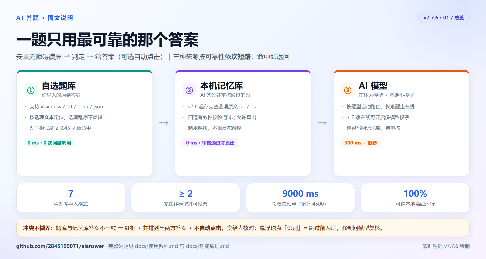
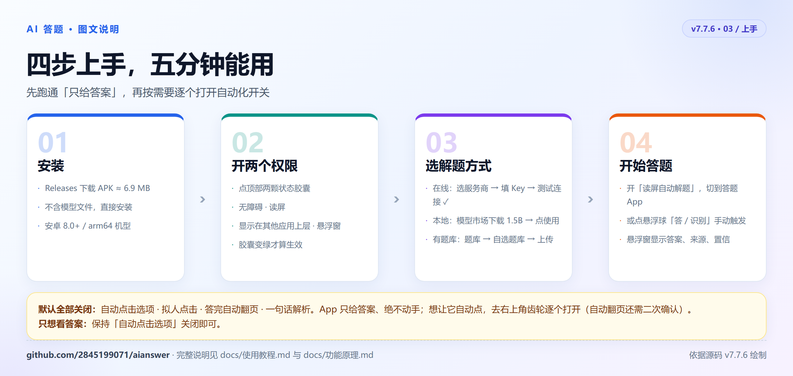
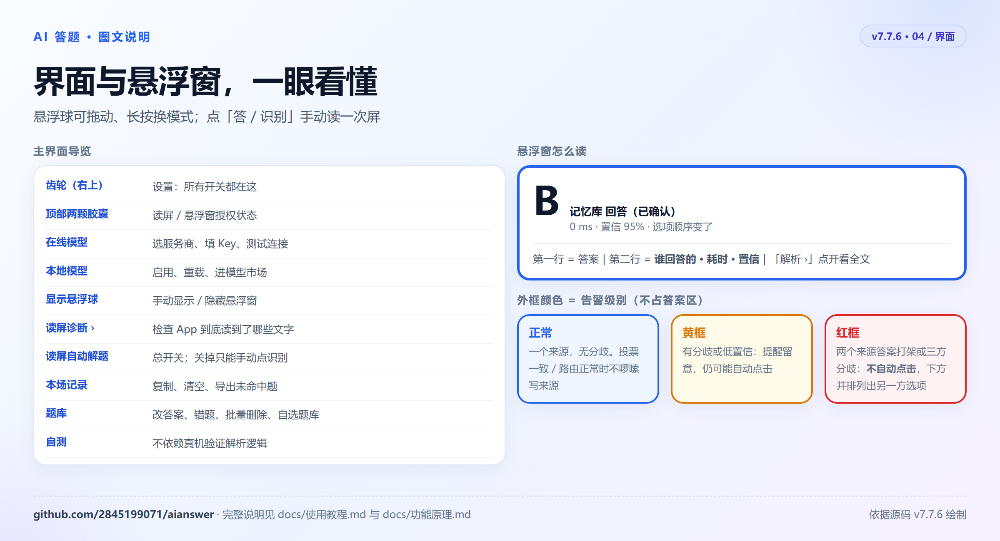

# AI答题 · 使用教程

> 适用版本：v7.7.6 ｜ 安卓 8.0+ ｜ 仅 arm64 设备
> 这是一份照着点就能用的说明书。想了解「为什么这么设计」，看[功能原理](功能原理.md)。
> **看图版**：[在线图文导览](https://2845199071.github.io/aianswer/)（本页同目录的 [index.html](index.html) 也可直接打开）。

---

## 0. 先搞清楚它是干什么的

App 通过**无障碍服务读取屏幕上的题目和选项**，把答案显示在悬浮窗里；你允许的话，它还可以**替你点选项、点下一题**。

它有三种答案来源，按顺序用，上层命中就不再往下走：

| 顺序 | 来源 | 速度 | 花钱吗 |
|---|---|---|---|
| ① | 你自己导入的**自选题库** | 毫秒级 | 不花 |
| ② | App 自己攒的**记忆库** | 0 ms | 不花 |
| ③ | **AI 模型**（在线大模型 / 本地小模型） | 0.3~1.5 s | 在线会花额度 |

**它不做什么**：不截图、不上传你的屏幕内容、不接管微信/浏览器、不自动交卷。识别不了图片题（图里没有文字）。

---

## 1. 安装与两个权限

1. 从 [Releases](https://github.com/2845199071/aianswer/releases/latest) 下载 APK 直接安装（约 6.9 MB，**不含模型文件**）。
2. 打开 App，点主界面上方两颗状态胶囊：
   - **「读屏 未开启」** → 跳到系统「无障碍」设置 → 找到「AI答题」→ 打开。
   - **「悬浮窗 未授权」** → 跳到系统「显示在其他应用上层」→ 允许。
3. 回到 App，两颗胶囊变绿/显示已开启，就可以继续了。

> 部分国产 ROM 会在后台杀掉无障碍服务。如果第二天发现不读屏了，先回这里看胶囊状态，重新开关一次。

---

## 2. 五分钟上手：只开在线（最省事）

1. 主界面「解题方式」→ 点**在线模型**卡片。
2. 选服务商（智谱免费档够用）→ 粘贴 API Key → 点**测试连接**，看到「✓ 连接正常」。
   - 智谱 Key 在 `open.bigmodel.cn` 注册后进控制台创建；DeepSeek 等在各自平台获取。
   - Key **只存在你手机本机**，不上传、不经任何中转。
3. 返回主界面，打开**「读屏自动解题」**开关。
4. 切到答题 App，悬浮窗会显示「思考中…」，随后显示答案。

只想看答案、不想让它动手：**不要打开「自动点击选项」**，默认就是关的。

---

## 3. 只开本地（断网也能用）

1. 主界面 → **本地模型** → 顶部「**模型市场 ›**」。
2. 每个模型都标了适用题型、体积、单题耗时、模板格式。选 1.5B 那档 → **下载**（约 1.07 GB，建议 Wi-Fi，支持断点续传）。
3. 下完点**使用**，状态变「使用中」。切换模型会重新加载，约 3~5 秒，期间答题按钮置灰。
4. 在线和本地可以同时开：默认「在线优先，失败自动回退本地」。

> 模型文件不进 APK，删掉 App 或清数据后需要重新下载；在模型市场里可以单独删除某个模型释放空间。

---

## 4. 主界面导览

| 位置 | 作用 |
|---|---|
| 右上角齿轮 | **设置**（所有开关都在这里） |
| 顶部两颗胶囊 | 读屏 / 悬浮窗授权状态，点一下直接跳系统设置 |
| **在线模型** 卡片 | 选服务商、填 Key、测试连接 |
| **本地模型** 卡片 | 启用本地、重载模型、进模型市场 |
| **显示悬浮球** | 手动显示/隐藏悬浮窗 |
| **读屏诊断 ›** | 看不到题时，用它检查 App 到底读到了哪些文字 |
| **读屏自动解题** | 总开关。关掉后只能点悬浮球上的「识别」手动触发 |
| **本场记录** | 本场答过的题、复制答案、清空、导出未命中题 |
| **题库** | 题库中心：改答案、错题、分歧、批量删除、自选题库入口 |
| **自测** | 不依赖真机，直接验证解析/匹配逻辑 |

---

## 5. 悬浮球怎么用

- **拖动**：按住悬浮球拖到不挡题的位置（位置会记住）。
- **点「答」/「识别」**：手动读一次屏。**手动「识别」= 强制复核**，会跳过自选题库和记忆库，直接问模型 —— 怀疑题库答案不对时点它。
- **长按**：弹出菜单，可换模式 / 隐藏悬浮窗。
- **悬浮窗文字怎么读**：
  - 第一行是大字母答案；下面一行写「谁回答的 · 耗时 · 置信」，例如 `自选题库 回答 · 0ms`、`记忆库 回答（已确认）· 0ms`、`在线 · DeepSeek 回答 · 820ms`。
  - 投票一致、路由正常时不会啰嗦地写一堆来源；只有**有分歧 / 有异常**时才展开说明。
  - **黄框** = 有分歧或低置信；**红框** = 两个来源答案打架或三方分歧，此时**不会自动点击**，答案下面会并排列出另一方的选项，请你自己核对。
  - 「解析 ›」点开看全文；悬浮窗里只显示 1 行，不占地方。

---

## 6. 导入自己的题库（强烈推荐）

如果你手上有考试题库，导入后命中就是 0 次网络调用、毫秒级出答案，也不怕 API 限流。

**入口**：主界面「题库」→ 顶部「**自选题库 ›**」→「上传题库文件」。

**支持格式**：`.xlsx / .xlsm / .csv / .tsv / .txt / .docx / .json`。老式 `.xls` 请先另存为 `.xlsx`。

**Excel 怎么排**（最常用）：

| 题型 | 题干 | A | B | C | D | 答案 | 解析 |
|---|---|---|---|---|---|---|---|
| 单选 | 减速机整体换油周期为每多少年？ | 2年 | 4年 | 6年 | 8年 | B | 按说明书每4年 |

- 表头不用放第一行：App 会在**前 30 行**里自动找真正的表头，能跳过「导入须知」这类说明行。
- 列名可以写「题目/题干」「选项A」「正确答案」「答案」等常见写法，识别结果会**先给你看预览再入库**。
- 答案支持 `B`、`ABD`（连写）、`A,B`、`正确/错误`、`√/×`，也可以**直接写选项原文**（如「4年」）。
- Word / 纯文本按「题号 + 选项行 + 答案行」切题；编码异常的老 txt 会自动尝试 GBK。

**几个要点**：

- 可以导入**多份**，会自动合并检索，不用切来切去。
- 匹配靠**选项文字**而不是字母，所以题库里的 A/B/C/D 顺序和屏幕上不一致也不会点错。
- 命中但屏幕上找不到对应选项文字时，App **不会硬点**，会降级问 AI，并把题库答案列在下面作对照。
- 题库文件可能被手机清理工具删掉。这时界面会明确写「**文件丢失，请重新导入**」，不会装作没导入过。
- 自选题库命中**不写进记忆库**，避免污染「AI 记住了 N 题」这个统计。

---

## 7. 题库中心

| 操作 | 怎么做 |
|---|---|
| 筛选 | 顶部「全部 / 有分歧 / 错题」，可叠加 |
| 改答案 | 点条目 → 改字母 → 保存。改过的答案变成**金标准**，模型以后不会再覆盖 |
| 批量删除 | 点「选择」进多选，或**长按某条**直接进多选；可跨筛选累计；删前二次确认，删后 **8 秒撤销条** |
| 看存了什么 | 详情页列出题干、答案、完整选项原文、来源、置信、命中次数 |
| 分歧题 | 两条来源答案不同时，会列在「有分歧」里；你采纳某一个或手改后，条目才算审核通过 |
| 清空 | 「本场记录」弹窗里区分「清空本场」（只清列表和统计）和「清空题库记忆」（下次重新推理） |

**审核机制**：新记忆默认「待确认」，模型第二次独立作答一致、或你手动确认后，才升级为「已确认」，此后才允许 0ms 直接出答案。出现分歧会打回待确认。

---

## 8. 本场记录与导出

「本场记录」弹窗里可以复制答案、清空本场、清空题库记忆、清零在线调用计数，以及**「导出未命中题」** —— 把自选题库没覆盖到的题导出到 `下载/AI答题/`，拿去补题库很方便。

---

## 9. 设置项逐条说明

设置分两组，以下默认值以 v7.7.6 为准。

### 解题行为 · 机器怎么动手

| 开关 | 默认 | 说明 |
|---|---|---|
| 自动点击选项 | 关 | 关着就只显示答案，不替你点 |
| 多自信才自动点击 | 55%（设置页滑块，示例 60%） | 低于阈值只显示不点。**点错比不点更亏** |
| 拟人点击 | **关** | 给点击加 80~200ms 随机延迟、落点偏 ±3dp，只改手感不改答案；开启需二次确认 |
| 答完自动点「下一题」 | **关** | 会一题接一题连答；开启需二次确认，且依赖「自动点击选项」 |
| 出答案时振动提示 | 开 | 不用一直盯着悬浮窗 |

> 自动翻页的四道保护：只有**真的点过选项**才翻、只在**答题那个 App 内**翻（切到微信不会被替你点「下一步」）、防连点 1200ms、找不到「下一题」或题干连续 3 次不变就停。

### 模型与额度 · 答案从哪来

| 开关 | 默认 | 说明 |
|---|---|---|
| 先查自选题库，没命中再问 AI | 开 | 没导入题库时不生效 |
| 自动选择模型（按题型路由） | 开 | 短题常识走本地，数学/文言/长题/多选多项走在线 |
| 多模型投票 | 关 | 需 **≥2 个已填 Key 的在线模型**，否则开关置灰；开启后「复核」自动关闭 |
| 拿不准时复核 | 关 | 只在低置信时再算一遍；两路不同标红且不自动点 |
| 出答案附一句解析 | 关 | 题库自带解析直接显示（不花钱）；AI 答案才会再花一次调用 |

**几个组合建议**：

| 场景 | 建议 |
|---|---|
| 平时随便刷、想省额度 | 导入题库 + 开路由 + 本地模型，自动点击关 |
| 批量刷固定卷子 | 导入题库 + 开自动点击 + 开自动翻页，拟人点击可开 |
| 正式考试有倒计时 | 只开在线/本地单通道，投票关（倒计时会自动切「抢答模式」，缩短等待） |
| 只想核对答案 | 全部自动点击关，手动点悬浮球「识别」 |

> 设置里会明确提示「看起来开着、其实不工作」的情况：只配了一条通道时，题型路由说明变橙色提示「暂不生效」；投票和路由同时开时提示「判为在线的题才投票，判为本地的不烧额度」。

---

## 10. 常见问题

| 现象 | 先查这里 |
|---|---|
| 悬浮窗一直「未就绪」 | 没配 Key 也没载入本地模型 → 回主界面配一种 |
| 读不到题 / 识别成页面标题 | 用「读屏诊断 ›」看读到了什么；H5 页面节点顺序可能怪，部分答题页不支持 |
| 只显示答案不点 | 检查「自动点击选项」是否开、置信是否低于阈值、是否出现红框分歧 |
| 显示「已自动点」但选项没高亮 | 极少数机型的点击被系统吞了；关掉「拟人点击」再试（节点点击优先，手势只作兜底） |
| 选项顺序和题库不一样 | 正常，按选项文字定位；若提示「选项对不上」，说明文字差异太大，会降级问 AI |
| 智谱报 429 | 免费档约 1 次/秒，切题太快了；会自动回退本地 |
| 倒计时一出现就变快 | 正常，「抢答模式」会少问几家、缩短投票预算。「已用 28:39」这类正计时**不会**触发 |
| 记忆库里旧题提示没有选项内容 | v7.6 之前存的旧记录，命中时会多问一次 AI 自动补齐，一次性 |
| 费电 / 费流量 | 关掉本地模型、关掉解析；在线模式每次答题只发题目文本 |
| 图片题答不出来 | 无障碍树里图片没有文字，当前不支持 |

---

## 11. 数据、权限与隐私

| 数据 | 存在哪 |
|---|---|
| 设置与 API Key | 本机 `SharedPreferences`，不上传 |
| 记忆库 / 题库 | App 私有目录，卸载即清 |
| 自选题库 | App 私有 `files/selfbanks/`，另有一份索引记录导入过的文件 |
| 导出的未命中题 | `下载/AI答题/` |
| 本地 GGUF 模型 | App 私有目录，可在模型市场删除 |
| 模型清单 | 打包在 `assets/models.json`，不发版也能加模型 |

**权限**：无障碍服务（必需，读屏 + 点击）、悬浮窗（必需）、互联网（仅在线模式 / 下载模型）。**不需要存储权限** —— 导入走系统文件选择器，导出走系统下载目录。

在线模式下，题目文本会发送给你选的服务商；只开本地则全程离线。App 本身没有后端、没有账号、不收集数据。
